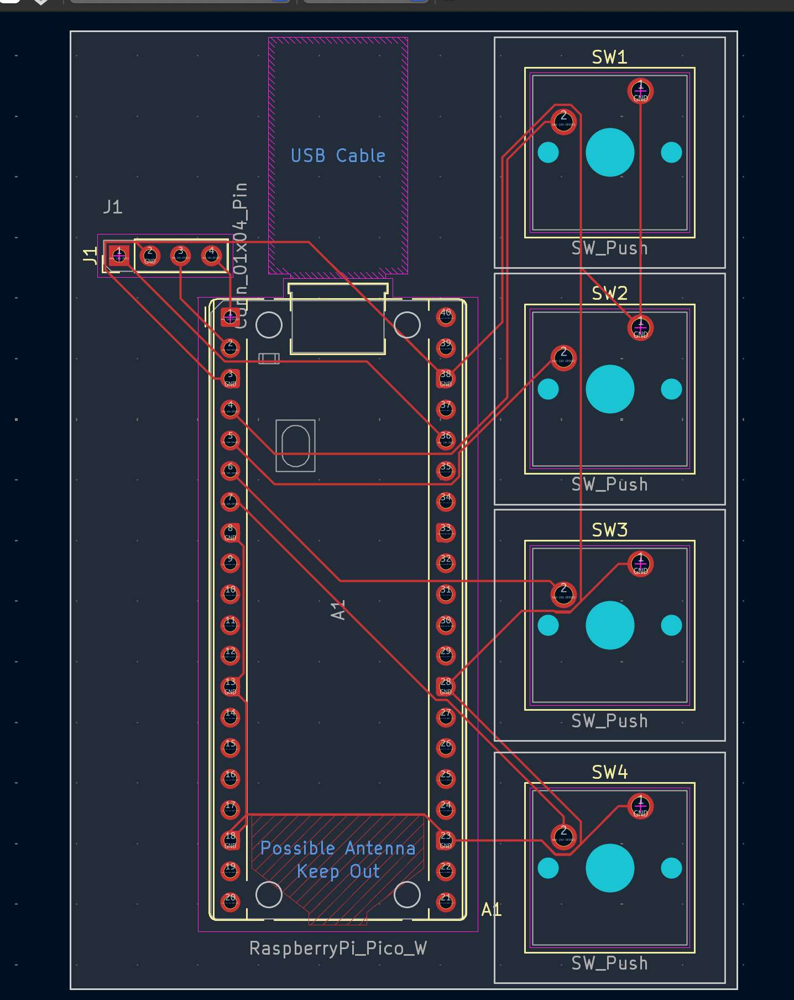
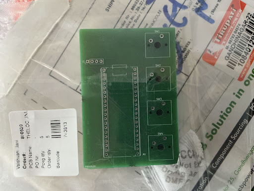

# Hack-Club-Projects-

## Project Overview

This project is a custom PCB design for a compact input/control board built around a microcontroller footprint and four push-button switch positions. The design includes the complete board layout, fabrication outputs, and a compact mechanical control interface intended for study-session productivity use.

## How The Timer Works

The Lock-In Clock is a productivity tracker designed to help me stay focused during study sessions. At its core, it acts as a Pomodoro timer. When powered on, the Raspberry Pi Pico W runs a MicroPython script that tracks countdown time, updates the display, and reads button inputs. The timer is centered around a 25-minute focus block and can be adjusted in 5-minute increments using the physical buttons on the custom PCB.

## What The 4 Buttons Do

I designed the custom PCB to hold 4 tactile Cherry MX Brown mechanical switches to control the timer without needing a mouse or keyboard.

- **Button 1 (Start/Pause):** Toggles the timer on or off. When pressed, the screen updates to say "LOCK IN" and the countdown begins. Pressing it again pauses the timer.
- **Button 2 (Reset):** Stops the timer immediately and resets the clock back to the default 25 minutes.
- **Button 3 (Add Time):** Adds 5 minutes (300 seconds) to the current timer block if I feel like I need a longer study session.
- **Button 4 (Subtract Time):** Subtracts 5 minutes from the current timer block in case I want a shorter sprint.

## How I Used AI in the PCB Layout

I used AI (specifically a large language model) as a troubleshooting and learning assistant while designing the PCB in KiCad. Because this was my first time designing a custom board, I used AI to help reason through layout constraints, component placement, signal routing, and the overall mechanical fit of the Raspberry Pi Pico W and button array.

## Included Design Files

- [BOM.md](BOM.md) — bill of materials
- [JOURNAL.md](JOURNAL.md) — build and design notes
- [README.md](README.md) — project documentation

## KiCad Project Files

The main KiCad source files for the PCB project are kept in the repository root so they can be opened directly in KiCad:

- [week 1 lock in module .kicad_pro](week%201%20lock%20in%20module%20.kicad_pro)
- [week 1 lock in module .kicad_sch](week%201%20lock%20in%20module%20.kicad_sch)
- [week 1 lock in module .kicad_pcb](week%201%20lock%20in%20module%20.kicad_pcb)
- [week 1 lock in module .kicad_prl](week%201%20lock%20in%20module%20.kicad_prl)

## Schematic and Fabrication Files

The repository contains the complete set of PCB fabrication and schematic output files used for the board design:

- [schematic-B_Cu.gbl](schematic-B_Cu.gbl)
- [schematic-B_Cu.gbr](schematic-B_Cu.gbr)
- [schematic-B_Mask.gbr](schematic-B_Mask.gbr)
- [schematic-B_Mask.gbs](schematic-B_Mask.gbs)
- [schematic-B_Paste.gbp](schematic-B_Paste.gbp)
- [schematic-B_Silkscreen.gbo](schematic-B_Silkscreen.gbo)
- [schematic-Edge_Cuts.gbr](schematic-Edge_Cuts.gbr)
- [schematic-Edge_Cuts.gm1](schematic-Edge_Cuts.gm1)
- [schematic-F_Cu.gbr](schematic-F_Cu.gbr)
- [schematic-F_Cu.gtl](schematic-F_Cu.gtl)
- [schematic-F_Mask.gts](schematic-F_Mask.gts)
- [schematic-F_Paste.gbr](schematic-F_Paste.gbr)
- [schematic-F_Paste.gtp](schematic-F_Paste.gtp)
- [schematic-F_Silkscreen.gbr](schematic-F_Silkscreen.gbr)
- [schematic-NPTH.drl](schematic-NPTH.drl)
- [schematic-PTH.drl](schematic-PTH.drl)
- [schematic-job.gbrjob](schematic-job.gbrjob)

## Project Gallery

The broken layout image links were replaced with the images uploaded above. These are the project images currently referenced in the gallery:

**1. Custom PCB Schematic:**

**2. Manufactured PCB (Delivered):**

## Notes

The repository is designed to document the PCB development process and provide the core fabrication-ready outputs for the project.

## Bill of Materials

| Part Name | Quantity | Unit Price | Buying Link |
| :--- | :--- | :--- | :--- |
| Raspberry Pi Pico W | 1 | 649.00 | [Robu.in](https://robu.in/) |
| 0.96 inch OLED with ssd1306 128x64 I2C | 1 | 169.00 | [Robu.in](https://robu.in/) |
| Mechanical Switch Brown Silent Click | 4 | 14.00 | [Sunrom.com](https://www.sunrom.com/) |
| Black DSA Keycap for MX Compatible | 4 | 19.00 | [Sunrom.com](https://www.sunrom.com/) |
| 1x40 Pin 2.54mm Female Strip | 2 | 98.00 | [Robu.in](https://robu.in/) |
| 1x40 Pin 2.54mm Male Header Strip | 2 | 9.00 | [Robu.in](https://robu.in/) |
| Custom PCB (55x79mm 2-layer) | 5 | N/A | [PCBPower.com](https://www.pcbpower.com/) |
